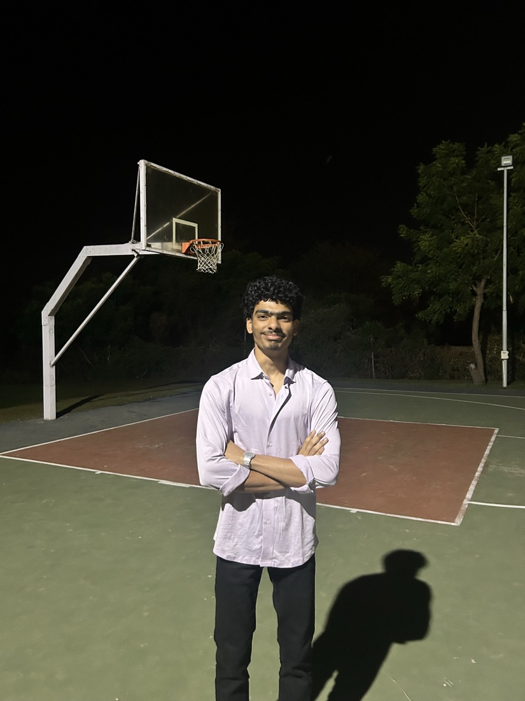
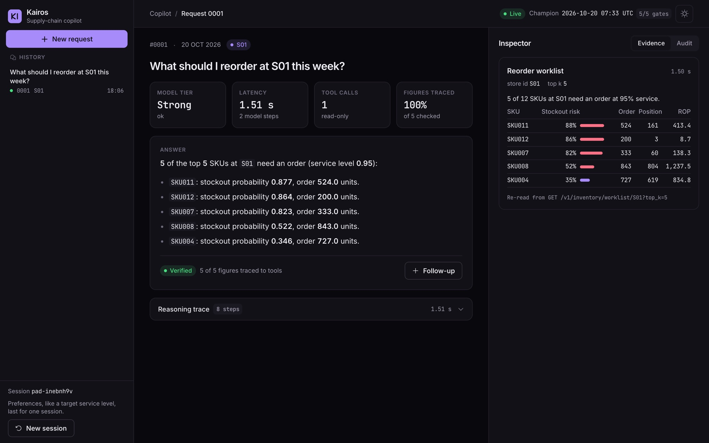
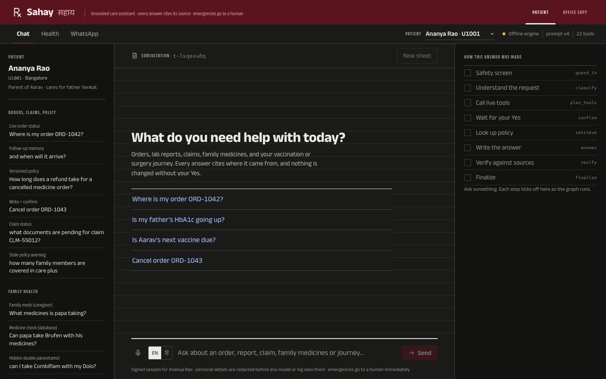

<div align="center">

<a href="https://ravikiranreddy.online">
  
</a>

# Bada Ravi Kiran Reddy

### AI/ML engineer building systems that can explain themselves.

Real-time computer vision. Grounded agents. Probabilistic forecasting. Production digital twins.

[](https://ravikiranreddy.online)
[](https://linkedin.com/in/ravikiranreddybada)
[](mailto:badaravikiranreddy@gmail.com)

</div>

---

I am an **AI/ML Engineering Intern at BLP Industry.AI**, working on production systems for airport operations in Bengaluru and Sydney. My work starts with models and data, but it does not stop there. I build the APIs, event pipelines, evaluation gates, deployment path and operator-facing experience around them.

My engineering rule is simple: if a system makes a claim, it should be able to show the evidence.

## The work

<table>
<tr>
<td width="50%" valign="top">

### Bengaluru International Airport

**Real-time terminal video analytics**

113 RTSP cameras feed NVIDIA DeepStream, YOLO tracking, Kafka and TimescaleDB. A deterministic replay rig mirrors every production camera across 8 subnets and caught 3 silent defects before deployment.

`Python` `FastAPI` `Kafka` `DeepStream` `TimescaleDB` `MediaMTX`

</td>
<td width="50%" valign="top">

### Sydney Airport T1

**Chiller plant digital twin and AI assistant**

An 8-month BMS audit produced 6 Energy Conservation Measures worth **A$72,072 per year**. The production twin pairs grounded tool-calling and Gemini Live with a React Three Fiber plant model on Google Cloud.

`BigQuery` `Gemini` `FastAPI` `React 19` `Three.js` `Cloud Run`

</td>
</tr>
</table>

### Kairos: decisions under uncertainty

<a href="https://kairos-web-mu.vercel.app">
  
</a>

A production-grade supply-chain platform that moves from demand segmentation to probabilistic forecasts, inventory policy and a grounded planning copilot.

- Champion LightGBM: **WAPE 0.324 / MASE 0.726**, with **82.8% coverage** on 80% conformal intervals (synthetic benchmark)
- Champion/challenger promotion with identical folds, a Diebold-Mariano test and one-command rollback
- Monte Carlo supply twin, two-echelon pooling and a four-eyes approval ledger
- LangGraph copilot with 13 typed tools, hybrid RAG, guarded text-to-SQL and a 36-case eval gate

[Live demo](https://kairos-web-mu.vercel.app) / [Source](https://github.com/Ravikiranreddybada/kairos)

### Sahay: safety before fluency

<a href="https://sahay-web-nu.vercel.app">
  
</a>

A healthcare assistant designed to serve **1 lakh daily users**, with safety and authorization enforced in the runtime rather than left to the model.

- 11-node LangGraph state machine with human confirmation before every write
- 22 tools across 5 authenticated MCP servers with per-user idempotency and IDOR prevention
- Zero-LLM emergency triage in English, Hinglish and Devanagari
- 78 golden and 24 held-out cases, 141 counterfactual runs and 123 tests
- Exactly-once vaccine reminders and a measured cost of **₹2.3 per conversation**

[Live demo](https://sahay-web-nu.vercel.app) / [Source](https://github.com/Ravikiranreddybada/sahay)

## How the portfolio is built

```text
verified S-Prep facts
        |
        v
src/data/profile.js  ->  React sections  ->  accessible motion  ->  static Vite build
        |                                         |
        +-- one content source                    +-- reduced-motion fallback
```

The site uses **React 19**, **Vite 8**, **Tailwind CSS 4**, **Motion**, **Phosphor Icons** and self-hosted **Geist** fonts. It supports system-aware light and dark themes, keyboard navigation, reduced motion and responsive layouts.

Content is deliberately centralized in [`src/data/profile.js`](src/data/profile.js). Project claims and numbers are sourced from the canonical S-Prep resume knowledge base. No decorative metrics and no unverified project claims.

## Run locally

```bash
git clone https://github.com/Ravikiranreddybada/ravikiranreddybada-portfolio.git
cd ravikiranreddybada-portfolio
npm install
npm run dev
```

```bash
npm run lint
npm run build
npm run preview
```

## Repository map

```text
src/
  components/       portfolio sections and shared UI
  data/profile.js   canonical public content
  App.jsx           page composition
  index.css         tokens, themes and motion rules
public/
  shots/            real project screenshots
  profile-sm.jpg    optimized portrait
```

## Current stack

| Layer | Tools |
|---|---|
| AI agents | LangGraph, LangChain, MCP, Claude, Gemini, tool calling, hybrid RAG |
| ML and data | LightGBM, scikit-learn, PyTorch, TensorFlow, SHAP, statsmodels, OpenCV |
| Backend | Python, FastAPI, Kafka, PostgreSQL, TimescaleDB, MongoDB, Redis, DuckDB |
| Frontend and 3D | TypeScript, React, Next.js, Three.js, React Three Fiber, Tailwind CSS |
| MLOps and cloud | Docker, Kubernetes, MLflow, GitHub Actions, Terraform, OpenTelemetry, GCP, AWS |

---

<div align="center">

**The polished interface is the visible layer. The real work is making every result traceable.**

[Open the portfolio](https://ravikiranreddy.online) | [Read the code](src) | [Get in touch](mailto:badaravikiranreddy@gmail.com)

</div>
